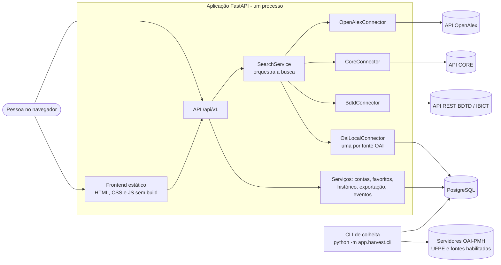
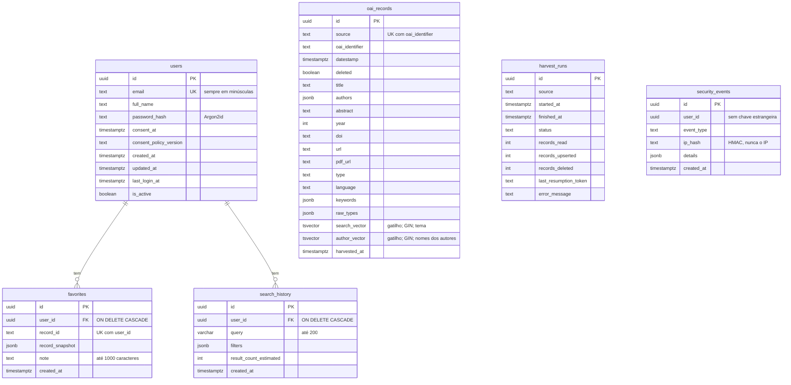

# Arquitetura

Visão geral de como o Academic Search Hub é montado. Os diagramas usam Mermaid, que o GitHub e o
VS Code (com a extensão de Markdown) desenham sozinhos.

## 1. Componentes

A aplicação é um processo só (FastAPI) que serve a API e o frontend estático, fala com um
PostgreSQL e consulta as fontes. Três fontes são consultadas **ao vivo** (OpenAlex, CORE e BDTD);
os repositórios OAI-PMH habilitados são **colhidos antes** para uma tabela local e pesquisados ali.



Pontos de projeto:

- **Conectores** seguem um contrato único (`slug`, `name`, `kind`, `is_enabled`, `availability`,
  `search`). Falhas viram um estado (`timeout`, `error`, `rate_limited`, `disabled`), nunca uma
  exceção que derrube a busca.
- **Sem estado no servidor:** autenticação por token JWT em cada requisição. O limite de
  requisições fica em memória, por isso o servidor roda com um processo (`app/run.py`).
- **Frontend sem build:** módulos JavaScript nativos, `textContent` em vez de HTML montado, política
  de segurança de conteúdo sem `unsafe-inline`; o token fica em memória e, por padrão, também na
  aba (`sessionStorage`, que some ao fechar a aba; a pessoa pode desmarcar "manter conectado" no
  login), **nunca** em `localStorage`.
- **Fontes externas só são acessadas** pelos conectores e pela CLI de colheita; os testes bloqueiam
  qualquer rede que não seja a do próprio computador.

## 2. Sequência de uma busca

```mermaid
sequenceDiagram
    actor P as Pessoa
    participant F as Frontend
    participant A as API /search
    participant S as SearchService
    participant C as Conectores (em paralelo)
    participant D as PostgreSQL

    P->>F: digita a consulta e filtros
    F->>A: GET /api/v1/search?q=...
    A->>A: valida parâmetros (422 se inválidos)
    A->>S: search(params, usuário opcional)
    par uma tarefa por fonte ativa
        S->>C: OpenAlex (HTTP, tempo limite)
    and
        S->>C: CORE (HTTP, tempo limite)
    and
        S->>C: fontes OAI locais
        C->>D: consulta full-text em oai_records
    end
    C-->>S: página por fonte (ou estado de falha)
    S->>S: intercala, deduplica (DOI; título+ano+sobrenome) e corta na página
    S->>S: completa resumos (raspagem, só se ligada) e marca favoritos
    alt todas as fontes falharam
        S-->>A: erro (502 com sources_status)
    else ao menos uma respondeu
        S-->>A: resultados e sources_status
        opt pessoa logada
            A-)D: grava a busca no histórico (em segundo plano)
        end
    end
    A-->>F: 200 JSON
    F-->>P: lista de resultados e avisos de fonte
```

Detalhes da paginação combinada: cada fonte recebe `ceil(page_size / nº de fontes)` itens por
página; depois da deduplicação o resultado é cortado em `page_size`. O total é uma **estimativa**
(soma dos totais informados pelas fontes, com possíveis duplicatas).

## 3. Modelo de dados



Observações:

- `oai_records` e `harvest_runs` pertencem à colheita e **não** têm relação com as contas.
- `security_events` guarda `user_id` **sem chave estrangeira** de propósito: os eventos de
  segurança sobrevivem à exclusão da conta (sem dados pessoais) e têm retenção própria.
- Ao excluir a conta, favoritos e histórico saem junto (`ON DELETE CASCADE`).
- `favorites.record_snapshot` guarda uma cópia do registro no momento de salvar, para o favorito
  continuar legível mesmo que a fonte mude.
- A busca em `oai_records` usa a configuração `pt_unaccent` (português sem acentos) e um índice
  GIN sobre `search_vector`, mantido por gatilho com pesos A (título), B (palavras-chave) e C
  (resumo). Os autores **não** entram nesse índice de tema.
- A busca **por autor** (`field=author`) usa outro índice: `author_vector`, também por gatilho, com os
  nomes do JSONB `authors` e a configuração `unaccent_simple` (só tira o acento; **sem radical**, para
  "Paulo" não casar com "Paula"). Foi criado pela migração `0003`, que também preenche os registros
  já colhidos. Nas fontes ao vivo, cada conector traduz o campo à sua maneira (OpenAlex:
  `raw_author_name.search`; CORE: `authors:`).

## 4. Fluxo de colheita OAI-PMH

A colheita é uma tarefa de linha de comando, não parte do servidor web. Rode sob demanda ou agende
(ver `docs/EXECUCAO.md`).

```mermaid
flowchart TD
    start([python -m app.harvest.cli run slug]) --> cfg[Lê config/oai_sources.yml<br/>fonte precisa de enabled: true]
    cfg --> run[Cria harvest_runs<br/>status running]
    run --> since{Há colheita<br/>anterior ok?}
    since -- sim e sem --full --> inc[from = data de início da última<br/>colheita com status ok<br/>colheita incremental]
    since -- não ou --full --> full[Colheita completa]
    inc --> list
    full --> list[ListRecords<br/>metadataPrefix oai_dc]
    list --> parse[Lê o XML com defusedxml<br/>limite de 50 MB por resposta]
    parse --> map[Mapeia Dublin Core<br/>para título, autores, ano, DOI,<br/>tipo, idioma, palavras-chave]
    map --> flag{Registro<br/>deleted?}
    flag -- sim --> del[Marca deleted = true]
    flag -- não --> up[Upsert em oai_records<br/>search_vector por gatilho]
    del --> next
    up --> next{resumptionToken?}
    next -- sim --> wait[Pausa OAI_HARVEST_DELAY_SECONDS<br/>em 503 respeita Retry-After] --> list
    next -- não --> done[Atualiza harvest_runs<br/>status ok e contagens]
    list -. erro .-> fail[Registra error_message<br/>status error ou partial]
```

Comandos da CLI: `identify` (mostra o `Identify` do servidor), `sets`, `dump` (grava fixtures),
`run <fonte>` (`--full`, `--limit`, `--max-pages`, `--dry-run`), `run-all` e `status`.

## 5. Estrutura do código

| Pasta | Conteúdo |
|---|---|
| `app/api/v1/` | Rotas da API, finas: validam, chamam um serviço e devolvem o resultado |
| `app/services/` | Regras de negócio: busca, deduplicação, favoritos, histórico, exportação, contas, eventos de segurança |
| `app/connectors/` | Contrato e implementações das fontes (OpenAlex, CORE, OAI local) |
| `app/harvest/` | Colheita OAI-PMH: cliente, mapeamento, colhedor e CLI |
| `app/scraping/` | Raspagem opcional de resumos (desligada por padrão) |
| `app/models/`, `app/db/`, `migrations/` | Modelos SQLAlchemy, sessão e migrações do Alembic |
| `app/schemas/` | Modelos Pydantic de entrada e saída |
| `app/core/` | Configuração, erros, logs, segurança, limite de requisições, cabeçalhos |
| `frontend/` | Páginas e módulos JavaScript |
| `tests/` | `unit`, `integration`, `contract`, `e2e`, `a11y` (ver `docs/TESTES.md`) |
