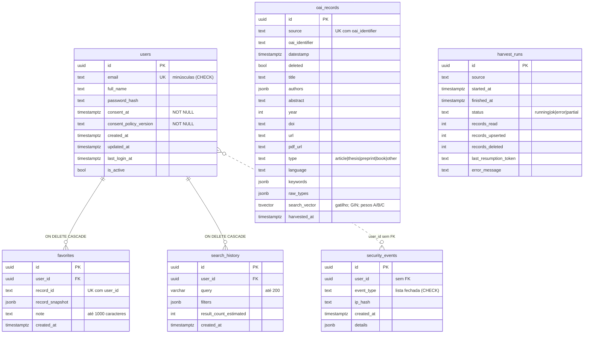

# Modelo entidade-relacionamento (OS-004)

Gerado a partir dos modelos em `app/models/`. `security_events.user_id` **não** tem chave
estrangeira de propósito: os eventos sobrevivem à exclusão da conta. `oai_records` e `harvest_runs`
se relacionam com a fonte apenas pelo texto `source` (o slug de `config/oai_sources.yml`).

