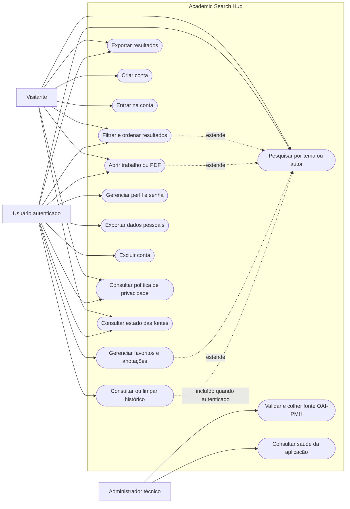
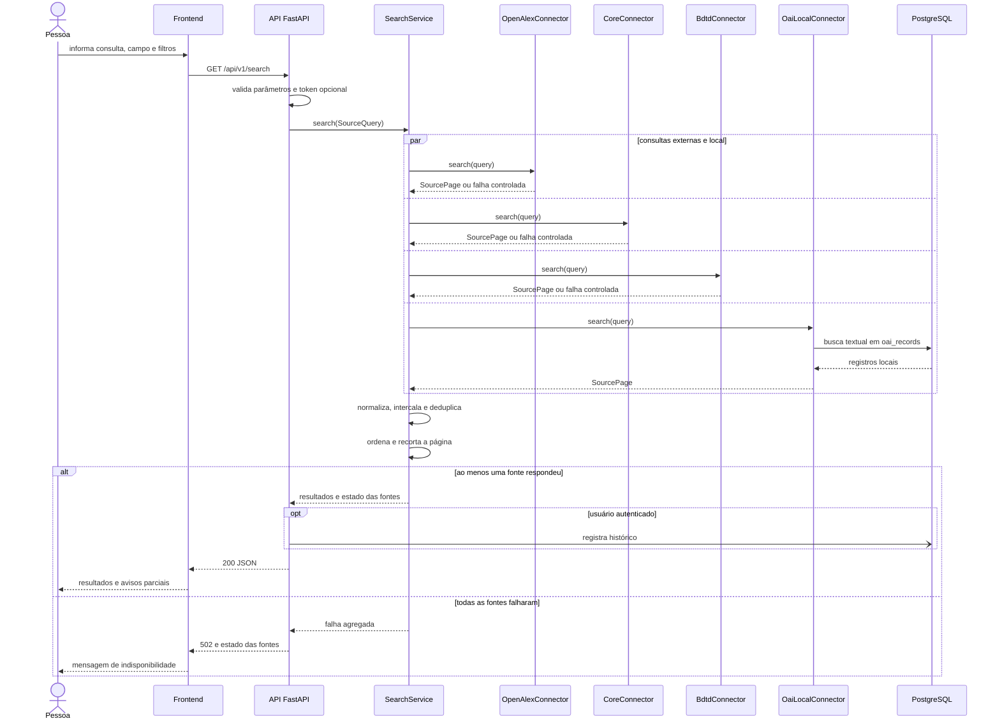
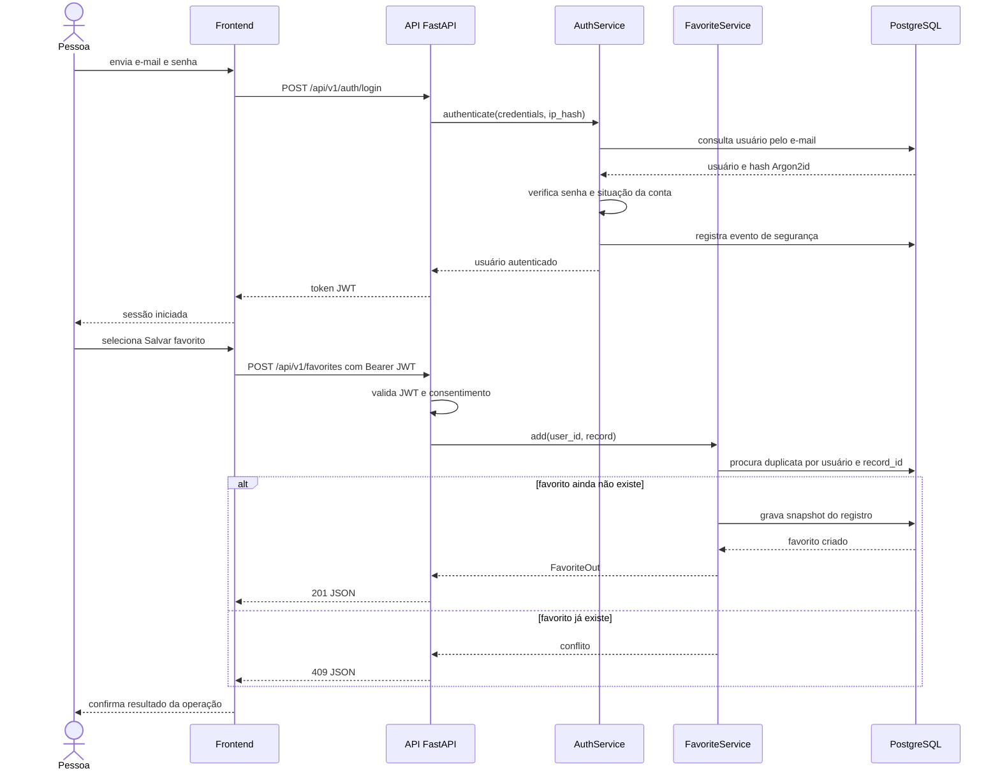
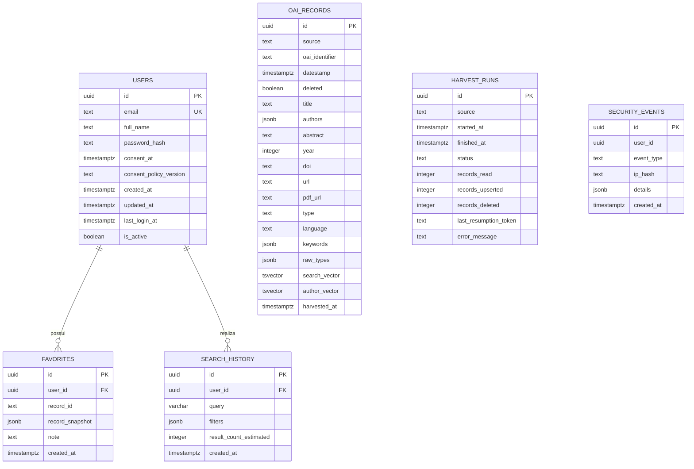
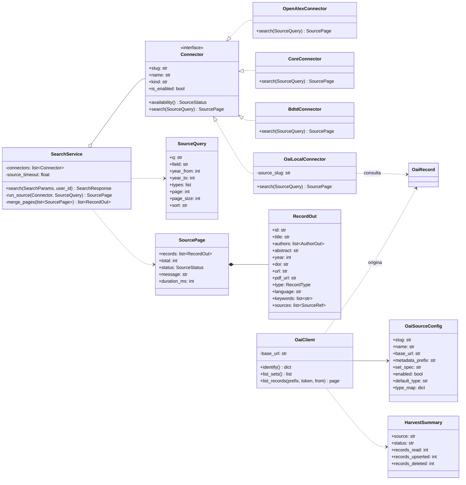

# Diagramas Mermaid do Academic Search Hub

Os diagramas abaixo foram derivados das rotas, serviços, conectores, modelos SQLAlchemy e migrações
existentes no projeto em 15/10/2026.

## 1. Diagrama de casos de uso

O Mermaid não possui uma notação UML nativa para casos de uso; o `flowchart` abaixo preserva os
atores, a fronteira do sistema e as relações funcionais.

## 2. Diagrama de sequência — busca unificada

## 3. Diagrama de sequência — autenticação e favorito

## 4. Diagrama entidade-relacionamento

Notas: `FAVORITES` possui unicidade composta em `user_id + record_id`; `OAI_RECORDS`, em
`source + oai_identifier`. `SECURITY_EVENTS.user_id` não é chave estrangeira, pois o registro de
segurança deve sobreviver à exclusão da conta. `OAI_RECORDS` e `HARVEST_RUNS` não pertencem a uma
conta de usuário.

## 5. Diagrama de classes

